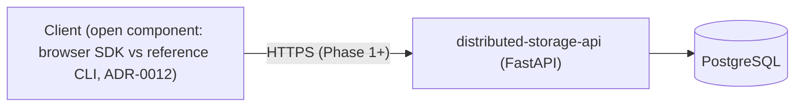
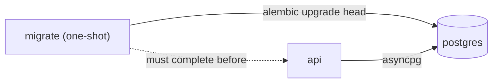
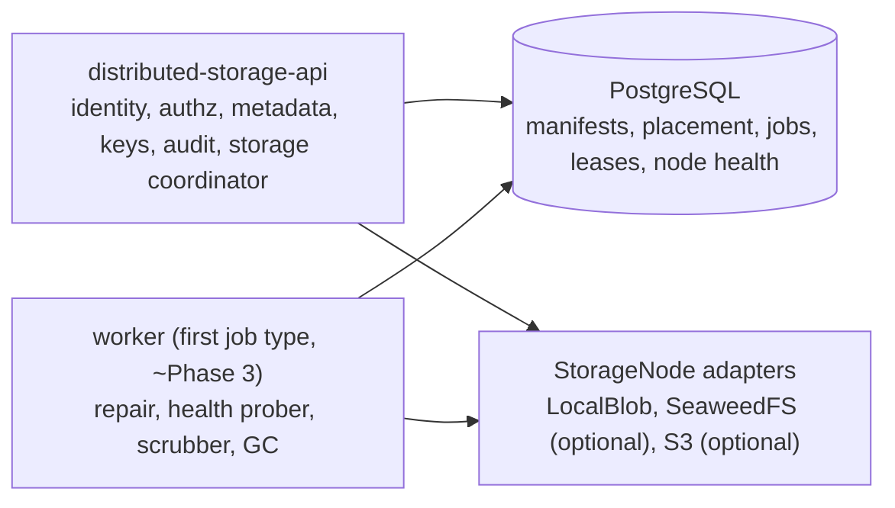

# Architecture (Phase 0 view)

Only what exists or is committed is drawn solid. Later components are listed as planned.
See [IMPLEMENTATION_PLAN.md](../IMPLEMENTATION_PLAN.md) for sequencing and [ADRs](adr/).

## Context

## Containers (Phase 0, Docker Compose)

## Planned (not built)

## Principles

- Modular monolith: one codebase, module boundaries are code boundaries (ADR-0001).
- PostgreSQL is the system of record and the job queue (ADR-0004).
- Distributed Storage owns erasure coding, placement, health, repair and integrity; storage nodes are dumb blob stores (ADR-0002).
