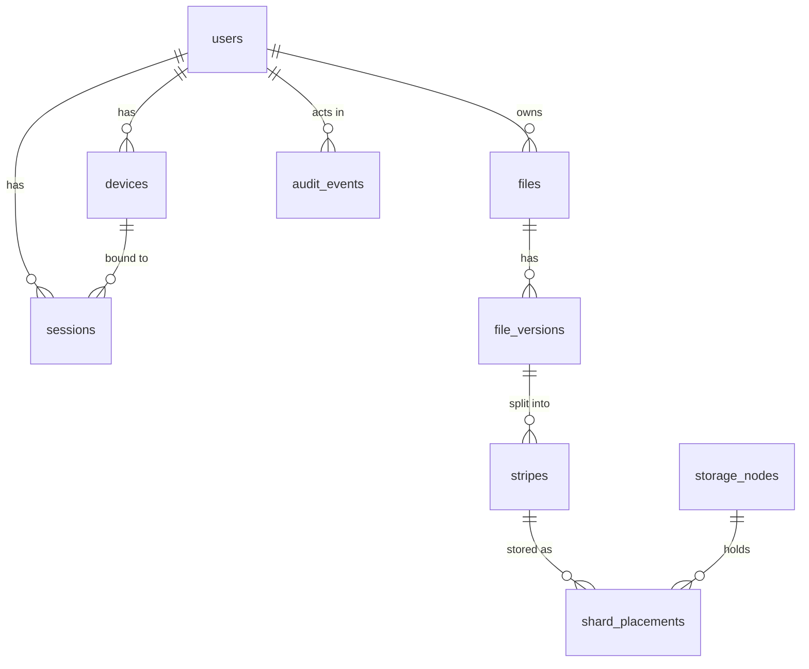

# Phase 1 data model (approved 2026-11-18, no migrations yet)

Conventions: UUID primary keys (`gen_random_uuid()`, core in PostgreSQL 13+, no extension),
`timestamptz` columns, all foreign keys `ON DELETE RESTRICT` (nothing is physically deleted in
Phase 1; users are disabled, not removed), state columns are `text` with `CHECK` constraints,
constraint and index names follow the naming convention in `distributed_storage/db/base.py`.

## Identity

**users**

| Column | Type | Notes |
|---|---|---|
| id | uuid PK | |
| email | text NOT NULL | stored lower-cased and trimmed; `UNIQUE` (D17) |
| auth_scheme | text NOT NULL | for example `argon2id-secret-v1`; lets the verifier change later |
| auth_verifier | text NOT NULL | Argon2id encoded hash of `auth_secret` (ADR-0011) |
| status | text NOT NULL | `CHECK in ('active','disabled')` |
| failed_login_count | integer NOT NULL default 0 | `CHECK >= 0` |
| locked_until | timestamptz NULL | backoff after repeated failures |
| created_at, updated_at | timestamptz NOT NULL | |

**devices**: id; user_id FK; name text (`UNIQUE (user_id, name)`); `ed25519_public_key` bytea NULL and
`x25519_public_key` bytea NULL (unused until Phase 2, not accepted by the API); created_at;
last_seen_at NULL; revoked_at NULL. Index on `(user_id)`.

**sessions**: id; user_id FK; device_id FK; `token_hash` bytea (SHA-256, 32 bytes, `UNIQUE`);
created_at; expires_at; last_used_at; revoked_at NULL. Indexes on `(user_id)`, `(device_id)`.
`CHECK (octet_length(token_hash) = 32)`. Raw tokens are never stored.

## Storage

**storage_nodes**: id; name text `UNIQUE`; adapter_type text (`CHECK in ('local')` for now);
location_ref text (non-secret, for example the blob root); failure_domain_id text NOT NULL;
state text `CHECK in ('healthy','suspect','down','retired')`; consecutive_failures int `>= 0`;
consecutive_successes int `>= 0`; last_seen_at NULL; created_at. Index on `(state)`.

**file_versions / stripes / shard_placements** hold the chunk, stripe and shard structure from day
one, so Phase 3 and 4 need no schema rewrite. In Phase 1 every version has exactly one stripe with
codec `none` and one shard.

## Files

**files**: id; owner_id FK users; current_version_id uuid NULL (set when a version commits; FK added
as deferrable); created_at. Index on `(owner_id, created_at DESC, id)` for keyset pagination.

**file_versions**: id; file_id FK; version_number int `>= 1`, `UNIQUE (file_id, version_number)`;
state `CHECK in ('planned','committed','deleting')`; size_bytes bigint (ciphertext size; `> 0`);
`metadata_format` text and `metadata_envelope` bytea (opaque to the server; Phase 1 stores
`dev-plain-v0` JSON, Phase 2 stores an encrypted envelope under a new format id; size-bounded);
created_at; committed_at NULL. `CHECK (state <> 'committed' OR committed_at IS NOT NULL)`.

**stripes**: id; file_version_id FK; stripe_index int `>= 0`, `UNIQUE (file_version_id, stripe_index)`;
codec_id text (`none` in Phase 1); data_shards int `>= 1`; parity_shards int `>= 0` (these columns
avoid the zfec `m` notation trap); data_length bigint; padding int `>= 0`; state `planned|stored|deleting`.

**shard_placements**: id (this UUID is also the blob key, ADR-0014); stripe_id FK; shard_index int `>= 0`,
`UNIQUE (stripe_id, shard_index)`; node_id FK; content_hash bytea (SHA-256, `CHECK octet_length = 32`,
known at upload time for single-shard stripes); length bigint `> 0`;
state `CHECK in ('planned','stored','deleting')` (Phase 4 adds `suspect`, `lost`); generation int
default 0 (fencing token for repair, Phase 4); created_at. Index on `(node_id)` (node-down scans) and
`(state)` for GC scans.

Invariant (Phase 4, not enforceable by a simple constraint): at most one shard of a stripe per failure
domain; verified by a property test and a repair-time check.

## Audit

**audit_events**: id bigint identity; occurred_at timestamptz; actor_user_id NULL; device_id NULL;
action text; resource_type text; resource_id text; outcome `CHECK in ('success','denied','failure')`;
request_id text NULL; details jsonb (never secrets, keys, tokens or email addresses).
A `BEFORE UPDATE OR DELETE` trigger raises an error, making the table append-only for ordinary
sessions. **This is not tamper evidence**: a database owner can drop the trigger. Hash chaining and
signed checkpoints arrive in Phase 7. Indexes: `(occurred_at)`, `(actor_user_id, occurred_at)`.

## Key flows and the queries they need

- Login: lookup by `users.email` (unique index); session creation; token validation by `sessions.token_hash`.
- Upload: one transaction inserts file, version (`planned`), stripe, placement; the blob is stored
  outside any transaction; a second transaction marks placement, stripe and version committed and
  sets `files.current_version_id`.
- Download: file by id and owner; committed version; placement `stored`; blob fetch; SHA-256 compare.
- Node scans (Phase 4): placements by `node_id` and `state`.

## Decisions recorded

Approved by the owner on 2026-11-18 ("approve all recommended"), with these answers to the review questions:

1. Identifier is the normalised `email` (D17); registration is controlled by a configuration flag.
2. `files.current_version_id` is nullable with a deferrable foreign key.
3. `metadata_envelope` is capped at 64 KiB in both the schema and the API.
4. Shard blob key is the placement UUID, write-once (D14, ADR-0014).
